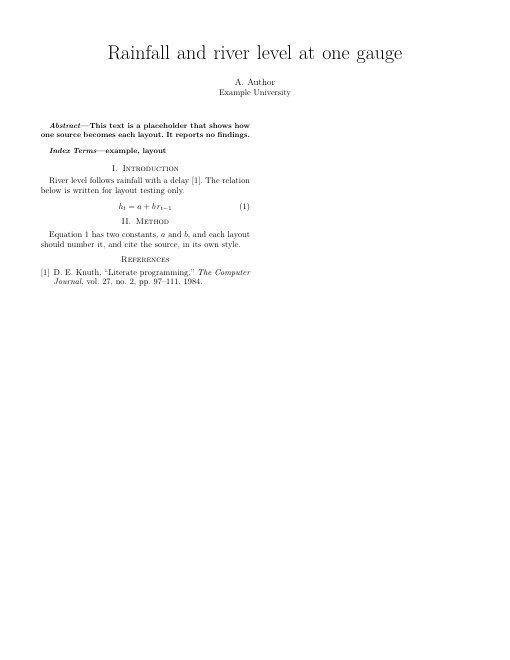
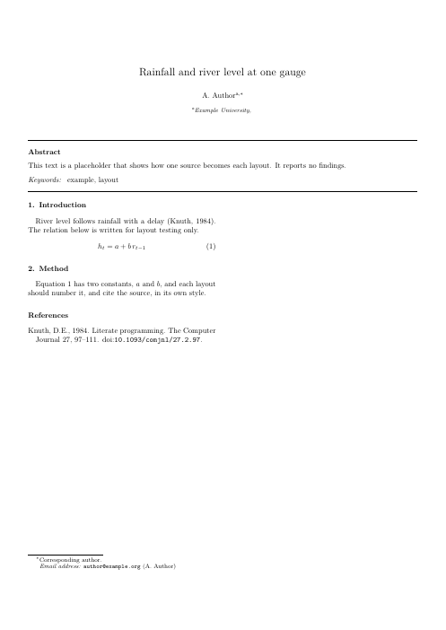
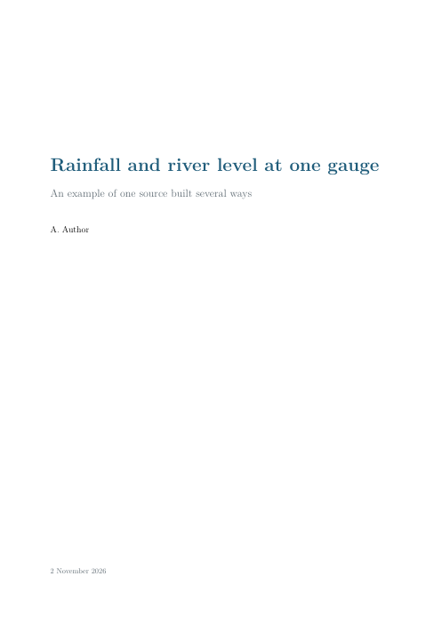
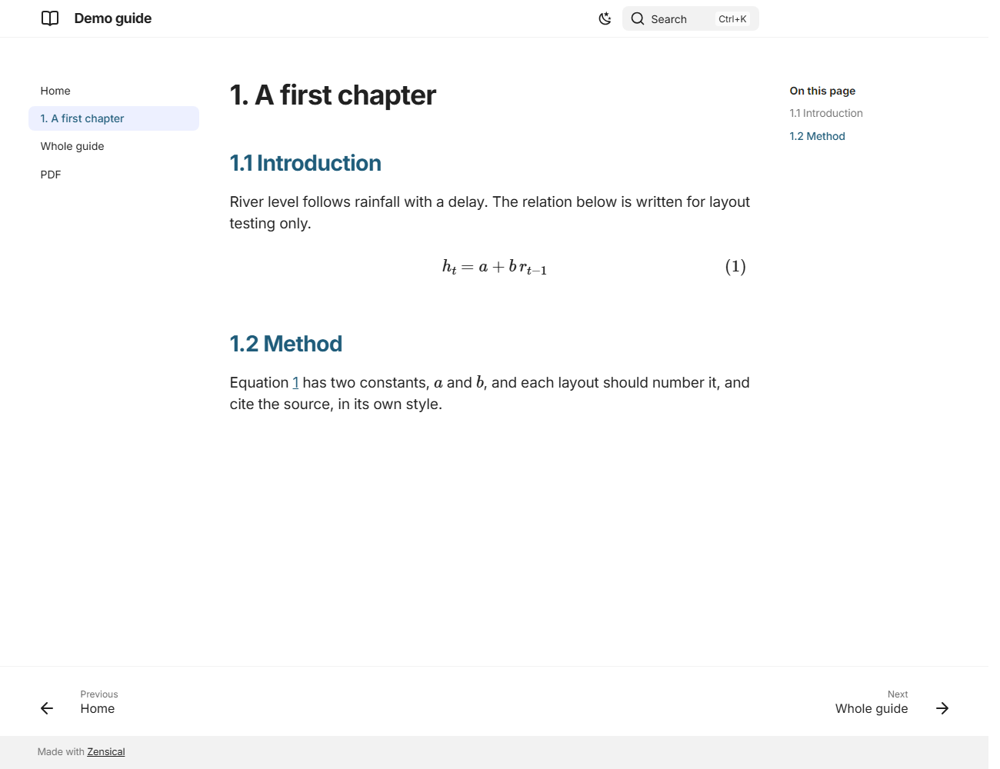

# research-helpers

Everyday helpers for reproducible research, collected from a PhD project and generalised for any project:

| Module | What it does | Command |
|---|---|---|
| `bib` | Verified BibTeX from DOIs (Crossref), title search, an author's works (OpenAlex), hand-off to Zotero | `rh bib`, `rh find-doi`, `rh author-works`, `rh zotero-push` |
| `open_access` | Download open-access PDFs for DOIs and check that each file is the right paper | `rh oa` |
| `latex2docx` | LaTeX to Word through pandoc, laid out like the PDF (numbering, cross-references, title page, page numbering, tables, contents), or on a publisher's Word template (IEEE) | `rh latex2docx` |
| `templates` | A local library of paper templates and citation styles from their official sources (IEEE, IGARSS, Elsevier, CSL), and new papers started from them | `rh template` |
| `safeio` | `keep()`: never overwrite an output; earlier versions are archived | – |
| `records` | Data register (sizes, checksums, sources) and a reference of scripts from their docstrings | `rh register`, `rh scripts` |
| `tables` | Results as LaTeX booktabs tables, written from data | – |
| `spatial_cv` | Spatial block folds, repeated block cross-validation, area of applicability of a model | – |
| `jobqueue` | Run long jobs one after another, after a condition, with a log (overnight runs) | `rh queue` |
| `litreview` | Scopus and Web of Science ingest and de-duplication, rule-based screening, reviewer agreement, PRISMA counts, bibliometrics | – |

## Slides to images and PowerPoint

`research_helpers.carousel` turns a slide PDF into square PNG images and a PowerPoint deck with speaker notes, for social media and teaching.

```python
from research_helpers.carousel import pdf_to_images, images_to_pptx

images = pdf_to_images("slides.pdf", "images", pixels=1440)
images_to_pptx(images, "slides.pptx", notes=["Read this aloud."] * len(images))
```

## Installation

Python 3.9 or later.

```bash
# latest version from GitHub
pip install "research-helpers[all] @ git+https://github.com/GeospatialGeeks/research-helpers"

# or a local copy, editable
git clone https://github.com/GeospatialGeeks/research-helpers
cd research-helpers
pip install -e ".[all]"
```

The core (`bib`, `open_access`, `latex2docx`, `safeio`, `records`, `jobqueue`, `tables`) needs only the standard library.
The extras add what the other modules need: `[data]` pandas and NumPy; `[spatial]` NumPy and SciPy; `[review]` pandas and NumPy;
`[all]` everything; `[dev]` pytest.

External tools, where used:
- `latex2docx` needs [pandoc](https://pandoc.org/installing.html) 2.11 or later. If it isn't on your PATH, set `RH_PANDOC=/path/to/pandoc`.
- `open_access` checks PDFs with `pdftotext` ([Poppler](https://poppler.freedesktop.org/)), or with `pypdf` if that is installed.
- The Zotero hand-off needs a running Zotero desktop app; set `ZOTERO_DATA_DIR` if your data folder isn't `~/Zotero`.

Check the installation with `rh --help` and `python -m pytest -q` (offline tests).

## Quick start

```bash
# references: verify, write BibTeX, and add them to a Zotero collection
rh bib refs.bib roberts2017=10.1111/ecog.02881 meyer2021=10.1111/2041-210X.13650 --zotero "My project"
rh bib refs.bib meyer2021=10.1111/2041-210X.13650 --expect 'meyer2021=area of applicability'   # rejects a DOI that resolves to another paper
rh find-doi "Spatial validation reveals poor predictive performance"
rh author-works "Jane Researcher" --institution "University" --since 2018 --csv works.csv

# open-access full texts
rh oa dois.txt pdfs/

# Word version of a LaTeX manuscript or thesis (A4, binding margin 40 mm, Arial 12 pt, 1.5 spacing)
rh latex2docx thesis/main.tex Thesis.docx --csl harvard.csl --margins 40,25,25,25

# paper templates: fetch the library once, then start papers from it; Word version of an IEEE paper on IEEE's template
rh template fetch
rh template list
rh template new ieee-conference papers/my-conference-paper
rh latex2docx papers/my-conference-paper/main.tex paper.docx --csl ieee.csl --profile ieee

# records of a project
rh register data/ --out records/data_register.csv
rh scripts code/ --out records/pipeline_reference.md

# an overnight queue that starts when another run has finished
rh queue jobs.txt --log night.log --after-file first.log --after-text "queue finished" --keep-awake
```

```python
from research_helpers.safeio import keep
from research_helpers.spatial_cv import block_folds, AreaOfApplicability
from research_helpers.litreview import ingest, screen, bibliometrics

df.to_csv(keep("results/metrics.csv"), index=False)              # the previous file goes to results/_archive/<time>/
folds = block_folds(x, y, block_size=2000, k=5, seed=0)          # spatial cross-validation
rec, dups = ingest.load(scopus=["scopus.csv"], wos=["savedrecs.txt"])
rec = screen.apply(rec, {"pop": r"building|dwelling", "out": r"energy"}, rule=screen.all_of(["pop", "out"]))
```

## Guides

Each module has a guide in [`docs/`](docs/) with its options, how it works, and the methods it follows (with references):
[bib](docs/bib.md), [open_access](docs/open_access.md), [latex2docx](docs/latex2docx.md), [safeio](docs/safeio.md),
[records](docs/records.md), [tables](docs/tables.md), [spatial_cv](docs/spatial_cv.md), [jobqueue](docs/jobqueue.md),
[litreview](docs/litreview.md), [templates](docs/templates.md). The full reference for each function is its docstring (`help(research_helpers.bib)`).

## Principles

- **Verify, don't trust.** DOIs are resolved and titles checked; downloaded PDFs are matched to the paper; data folders are hashed.
- **Never overwrite.** Outputs are archived before being replaced; raw data are never written by code.
- **Document where the code is.** Every module and script explains what it reads, does and writes in its docstring, and the records are built from those docstrings.
- **Only open services, no personal data sent.** Crossref, doi.org, OpenAlex and Semantic Scholar are used without accounts; publisher APIs only with your own key.

## Citing

If these helpers are useful in published work, please cite the repository:

Ahmad Ammar (2026) *research-helpers: everyday helpers for reproducible research*. GitHub. https://github.com/GeospatialGeeks/research-helpers

## Ownership and funding

Copyright © Ahmad Ammar. Developed during a PhD at Ulster University, supported by a Vice-Chancellor's Research Scholarship (VCRS). Released under the MIT licence.

## Licence

MIT (see [LICENSE](LICENSE)). The methods implemented are credited in each guide; please cite the original papers when you use them.

## One source, every layout

`research_helpers.stack` builds a project from LaTeX to PDF and to a website with one command. It adds a thin layer over latexmk, Pandoc, PDF.js and [Zensical](https://zensical.org), and it does not change your source files. A `document.toml` beside the source names the title, authors, chapters and layouts.

```
python -m research_helpers.stack layouts            # list what can be built
python -m research_helpers.stack pdf examples/demo  # one PDF per layout
python -m research_helpers.stack web examples/demo  # chapters, one long page, PDF reader
python -m research_helpers.stack check examples/demo     # file names and missing files
python -m research_helpers.stack snapshot examples/demo  # dated pictures of every output
```

Moving a paper to IEEE format means asking for the layout: `stack pdf . ieee`. A required template, such as a thesis class, stays as it is and is built with the `own` layout. Spacing and colours are set once in `stack/tokens.toml`, which both the PDF style and the web style read, so a change there reaches every project at the next build.

| IEEE | Two-column Elsevier | Manual | Web page |
|---|---|---|---|
|  |  |  |  |

These pictures come from `examples/demo`, whose text is a placeholder.
